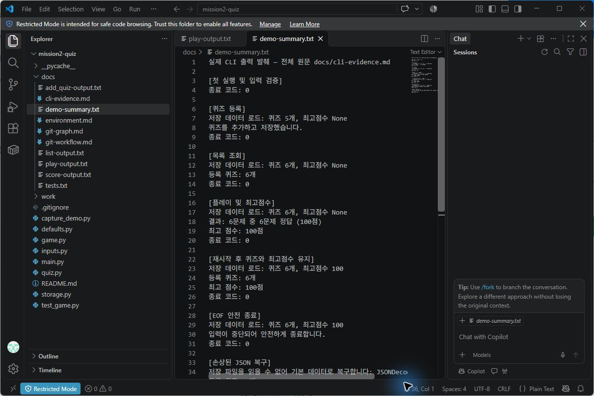
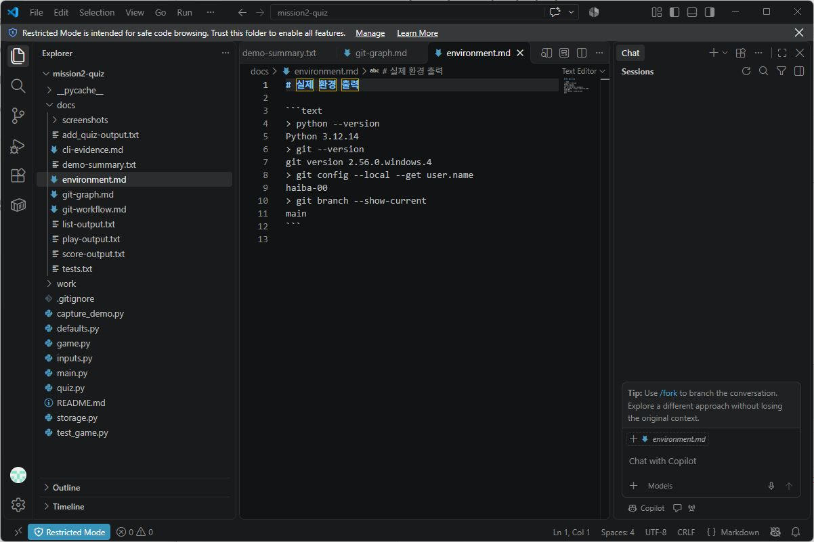
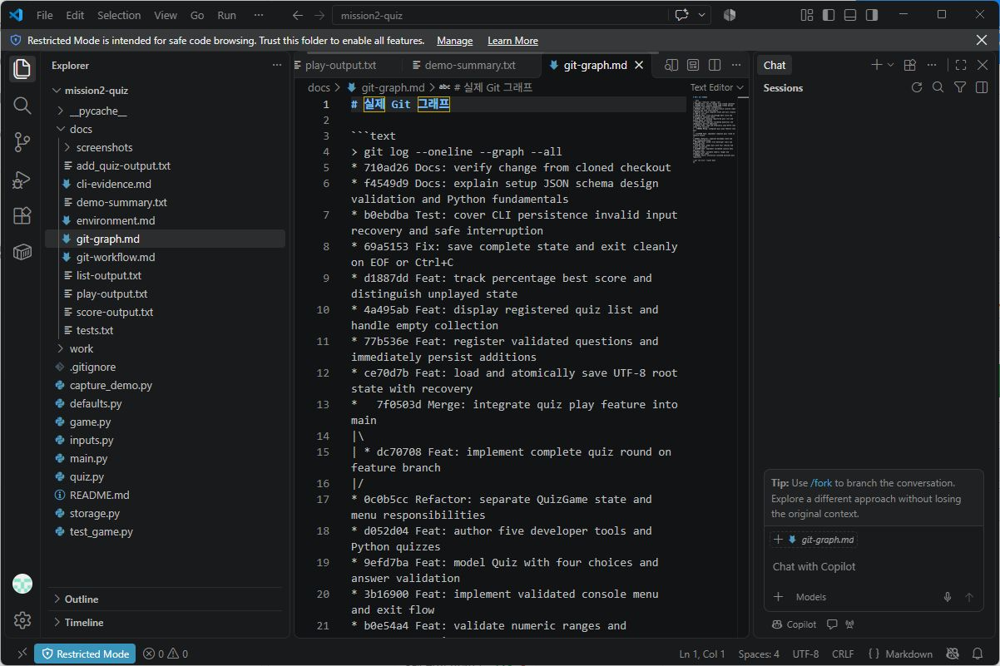

# 작업실 퀴즈 — haiba-00 미션2

## 프로젝트 개요와 주제

개발 도구와 Python 기초를 복습하는 콘솔 퀴즈다. 미션1의 Git·Docker와 미션2의 자료형·파일 인코딩을 연결해 학습 내용을 바로 확인할 수 있어 이 주제를 선택했다. 직접 작성한 기본 문제 5개가 포함된다.

## 실행 환경과 방법

Python **3.10 이상**, 표준 라이브러리만 사용한다. 검증 환경은 Windows, PowerShell, Python 3.12.14, Git 2.56.0.windows.4다.

```powershell
git clone https://github.com/haiba-00/mission2-quiz.git
cd mission2-quiz
python -X utf8 main.py
```

Windows에서 python 명령이 Microsoft Store를 열면 설치된 Python 3.10 이상 실행 경로를 지정하거나 py -3 main.py를 사용한다. VS Code에서는 이 폴더를 열고 해당 Python 인터프리터를 선택한다. 별도 pip 설치는 없다.

## 기능

1. 퀴즈 풀기: 저장된 문제 전체를 순서대로 출제하고 정오답·정답 번호·최종 점수를 보여준다.
2. 퀴즈 추가: 문제, 빈 값이 아닌 선택지 4개, 정답 1~4를 검증하고 즉시 저장한다.
3. 퀴즈 목록: 번호와 문제를 표시하며 비어 있을 때 안내한다.
4. 점수 확인: 미플레이와 0점을 구분하고 최고 백분율 점수를 표시한다. 낮은 점수로 갱신하지 않는다.
5. 종료: 저장 후 종료한다. Ctrl+C·EOF도 안내 후 가능한 범위에서 저장한다.

숫자 입력은 strip 후 int로 변환한다. 빈 값·abc·범위 밖 숫자는 안내 후 다시 입력받는다. 등록 도중 중단되면 미완성 문제를 추가하지 않는다. 진행 도중 중단한 라운드는 완료 점수로 기록하지 않는다.

## 파일 구조

```text
mission2-quiz/
├── main.py              # 진입점, Ctrl+C/EOF 안전 종료
├── inputs.py            # 공통 숫자·문자 입력 검증
├── quiz.py              # Quiz: 문제·선택지·정답, 출력·정답 확인
├── defaults.py          # 기본 퀴즈 5개
├── game.py              # QuizGame: 메뉴·플레이·추가·목록·점수
├── storage.py           # StateStore: JSON 검증·원자적 저장
├── state.json           # 첫 종료/저장 시 생성, 개인 상태라 Git 제외
├── test_game.py         # 표준 unittest 13개
├── capture_demo.py      # 실제 CLI 하위 프로세스 7회 검증
└── docs/                # 실제 실행·테스트·Git 기록 및 화면 증거
```

## 데이터 파일

기본 경로는 **프로젝트 루트 state.json**이다. 현재 터미널 위치가 달라도 storage.py의 위치를 기준으로 계산한다. UTF-8 및 ensure_ascii=False로 한글을 저장한다.

```json
{
  "quizzes": [
    {"question": "문제", "choices": ["가", "나", "다", "라"], "answer": 1}
  ],
  "best_score": null
}
```

best_score는 미플레이일 때 null, 완료 후 0~100 정수다. 빈 quizzes는 정상 상태로 취급한다. 파일 없음·잘못된 JSON·잘못된 스키마·읽기 오류는 기본 퀴즈로 시작한다. 다음 저장에 복구된 상태를 기록한다. 저장은 같은 폴더의 임시 파일에 쓰고 flush/fsync 후 교체한다. 실패하면 기존 파일을 보존하고 안내하며 메모리 데이터는 유지한다. 정상 상태는 state.json.bak에 1세대 보존하고, 손상 파일은 state.json.corrupt-UTC시각으로 별도 보존한다. 아래 백업·복구 정책을 따른다.

## 실제 검증과 증거

- [실제 CLI 입력과 전체 출력](docs/cli-evidence.md): 첫 실행, 입력 오류, 추가, 목록, 플레이·점수, 재시작 영속성, EOF, 손상 복구.
- [자동 테스트 전체 출력](docs/tests.txt): 13개 통과. Ctrl+C/EOF, 쓰기 실패 시 기존 파일 보존, 빈 목록, 스키마 검증 포함.
- [Git 워크플로우](docs/git-workflow.md): 실제 clone→복제본 수정·commit·push→원본 pull과 반영 확인.
- [Git 그래프](docs/git-graph.md): 기능별 10개 이상 커밋과 feature/play 병합.
- [환경 정보](docs/environment.md).

```powershell
python -X utf8 -m unittest -v
python -X utf8 capture_demo.py
```

테스트는 임시 경로, CLI 검증은 work/demo 복사본을 사용하므로 사용자 state.json을 바꾸지 않는다. 제한된 환경에서 임시 폴더 접근이 막히면 쓰기 가능한 폴더로 TEMP/TMP를 지정한다. 저장 테스트는 실제 파일 쓰기와 재로드로 확인하며 단순 성공 문구만 검사하지 않는다.

## Python과 Git 설명

변수는 값을 이름으로 참조한다. int는 정수, str은 문자열, bool은 참/거짓, list는 순서 있는 목록, dict는 키/값 구조다. 메뉴는 if/elif, 전체 메뉴 반복은 while, 문제와 선택지 순회는 for를 사용한다. read_number의 매개변수는 범위와 안내 문구이고 반환값은 검증한 정수다.

Quiz는 개별 문제, QuizGame은 게임 흐름, StateStore는 저장을 담당한다. 클래스는 속성과 동작을 묶는 설계이며 객체는 그 인스턴스다. Quiz의 dataclass가 생성하는 __init__는 문제 속성을 초기화하고 __post_init__가 검증한다. self는 해당 객체다. QuizGame.__init__는 기본값과 저장 데이터를 준비한다.

JSON은 목록·객체·숫자 등으로 구성된 텍스트 형식이라 사람과 프로그램 모두 다루기 쉽다. with open으로 열고 json.load/dump로 읽고 쓰며 try/except로 오류를 처리한다.

Git의 init은 저장소 생성, add는 변경 선택, commit은 이력 기록, push는 원격 전송, clone은 새 복제, pull은 원격 변경 가져오기·병합, checkout은 브랜치 전환이다. 플레이는 feature/play에서 구현하고 main으로 --no-ff merge하여 병합 이력을 남겼다. 작성자는 이 저장소에만 haiba-00으로 설정했다.

## 트러블슈팅

- Windows 기본 출력 인코딩: 한글이 깨질 수 있어 -X utf8로 실행하고 로그를 UTF-8로 직접 저장했다.
- 제한된 TEMP 접근: 초기 파일 검사에서 PermissionError 발생. 작업 폴더 아래의 임시 경로로 바꿔 테스트했고 10개가 통과했다.
- 메뉴 연결 검사: 초기 클래스 메서드 추가 후 메뉴 분기 연결이 빠진 것을 확인하여 수정하고 실제 추가·목록·점수 CLI 시나리오로 검증했다.

필수 기능을 대상으로 구현했다. 랜덤·힌트·삭제·히스토리 등 선택 보너스는 포함하지 않는다. 저장소 링크가 제출물이며 네이토 사전평가는 자동 실행하지 않는다.

복제·동기화 실습: 별도 clone 작업 폴더에서 이 문장을 추가하고 원본에서 pull로 반영했다.

## 실제 출력 화면 캡처

실제 subprocess stdout 발췌와 Git 명령 출력을 VS Code에서 열어 캡처했다. 원문과 입력 순서는 CLI 증거 파일에 있다.





## JSON 저장의 성능·메모리 한계 (평가 #18)

현재 구현은 소규모 개인 퀴즈용이다. json.load는 전체 JSON을 한 번에 읽고 dict/list와 Quiz 객체를 구성한다. 데이터 크기를 B, 퀴즈 수를 N이라고 하면 읽기·검증 시간은 대략 O(B+N), 메모리 사용은 O(B+N)이다. Python 객체와 문자열, 역직렬화 중간 목록이 함께 존재하여 실제 메모리는 파일 크기보다 클 수 있다. save도 전체 문제를 dict 목록으로 변환하고 파일 전체를 다시 쓰므로 O(B+N)의 시간과 추가 메모리가 필요하다. 정답 하나가 아니라 퀴즈·최고점수가 바뀔 때 저장한다.

정상 이전 파일을 .bak에 복사하는 데 O(B) 시간과 디스크 공간이 추가된다. flush/fsync는 안정성을 높이지만 저장 지연을 유발할 수 있다. 단일 사용자·단일 실행을 전제로 하며 파일 잠금이 없어 동시 실행하면 마지막 저장이 앞선 변경을 덮어쓸 수 있다. 임시 파일 교체는 중간 JSON 노출을 줄이지만 다중 프로세스 트랜잭션을 제공하지 않는다.

데이터가 커지면 표준 라이브러리 sqlite3의 SQLite로 전환하여 문제별 행 저장, 인덱스 조회, 부분 갱신, 트랜잭션을 사용할 수 있다. 목록은 페이지 단위로 읽어 메모리를 제한한다. mmap은 파일의 필요한 구간 접근에 유용하지만 일반 JSON을 json.load로 전부 해석하는 현재 구조의 객체 생성 비용을 없애지는 않는다. mmap만 덧붙이기보다 SQLite 또는 스트리밍 가능한 JSON Lines 등 데이터 형식을 먼저 검토해야 한다. 이 설명은 복잡도 분석이며 성능 벤치마크 수치를 주장하지 않는다.

## 백업·자동 복구 정책 (평가 #19)

- 저장 직전 현재 state.json을 스키마 검증한다. 정상이면 state.json.bak에 직전 정상 버전을 1세대 보존한다. 첫 저장에는 이전 버전이 없으므로 .bak가 아직 없을 수 있다.
- 현재 파일이 손상됐으면 UTC 시각을 붙인 state.json.corrupt-* 파일로 원본을 복사한다. 읽기 권한 등으로 복사가 실패하면 안내하고 원본은 건드리지 않는다.
- 현재 파일이 없거나 잘못됐으면 .bak도 같은 스키마로 검증하여 자동 복구한다. 다음 저장/정상 종료 시 복구된 메모리 상태를 state.json으로 기록한다. 손상된 현재 파일로 정상 .bak를 덮어쓰지 않는다.
- 정상 백업도 없거나 손상됐으면 기본 5문제와 미플레이 점수로 시작한다. 백업은 직전 저장 버전이므로 가장 최근 변경은 유실될 수 있다. 디스크 고장이나 외부 삭제까지 보호하는 원격 백업은 아니다.
- .bak 갱신 실패 시 새 저장도 실패 안내를 내고 기존 state.json을 유지한다. 손상 보존 파일은 자동 삭제하지 않으므로 사용자가 내용을 확인한 뒤 별도 보관하거나 정리한다. state.json.*는 .gitignore로 공개 업로드에서 제외한다.

수동 복원이 필요하면 게임을 종료하고 프로젝트 루트에서 실행한다. 현재 파일을 먼저 별도 보존한다.

```powershell
# 필요할 때 실행하는 수동 복구 예시. 현재 파일이 존재하는 경우:
Copy-Item -LiteralPath state.json -Destination ("state.json.manual-" + (Get-Date -Format yyyyMMddHHmmssfff))
# .bak를 먼저 확인하고 정상일 때만 복원:
python -X utf8 -c "from pathlib import Path; from storage import StateStore; print(StateStore()._read(Path('state.json.bak')))"
Copy-Item -LiteralPath state.json.bak -Destination state.json -Force
python -X utf8 main.py
```

자동 테스트는 손상 원본 보존, .bak에서 점수 복원, 주 파일 누락 복구, 잘못된 백업의 기본값 전환을 실제 파일로 확인한다. [최신 테스트 결과](docs/tests.txt).
